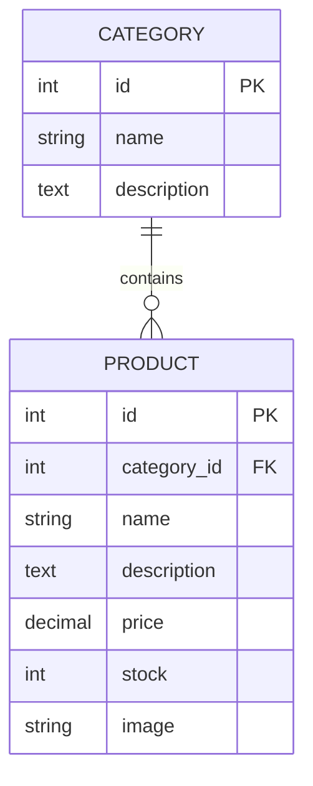

# Laboratorio 13 — Estructura de una aplicación de comercio electrónico

Documentación técnica del back-end con **Django REST Framework** y del cliente con
**React + Vite + Axios**, desarrollados en `semana13/backend` y `semana13/frontend`.

- Repositorio: `https://github.com/ymerino-dev/DAE-4C24A_2026.git`
- Rama: `main`
- Modelos: `Category` y `Product` (en singular), en la aplicación dedicada `catalog`.
- Idioma del código: 100 % inglés. Estilo: PEP 8 en Python; componentes en PascalCase
  y hooks con prefijo `use` en React.

---

## 1. Arquitectura y reparto de responsabilidades

```text
 Navegador (http://localhost:5173)
 ├─ React + Vite + React Router
 ├─ Componentes: ProductCatalog, ProductForm, NavBar
 └─ Capa de servicios: apiClient → categoryService / productService
              │  HTTP + JSON / multipart-form-data + CORS
              ▼
 Servidor (http://127.0.0.1:8000)
 ├─ Django 6.1.3 + DRF + django-cors-headers + Pillow
 ├─ /api/categories/  → CategoryViewSet
 ├─ /api/products/    → ProductViewSet (filtro ?category=<id>)
 ├─ /admin/           → administración de Category y Product
 └─ /media/           → imágenes servidas cuando DEBUG=True
              │
              ▼
     db.sqlite3  +  media/products/*.png (generados por seed.py)
```

### 1.1 Servidor Back-End (`semana13/backend`)

Responsabilidades:

| Archivo | Responsabilidad |
|---|---|
| `config/settings.py` | Configuración con `os.environ.get` (sin credenciales hardcodeadas), CORS, `MEDIA_URL` y `MEDIA_ROOT`. |
| `config/urls.py` | `DefaultRouter` con `/api/categories/` y `/api/products/`; sirve `/media/` solo si `DEBUG` es `True`. |
| `catalog/models.py` | Modelos `Category` y `Product` con la relación `ForeignKey`. |
| `catalog/serializers.py` | Lectura anidada de la categoría y escritura por `category_id`. |
| `catalog/views.py` | `ModelViewSet` para ambos modelos, filtrado opcional y parsers multipart. |
| `catalog/admin.py` | Registro con `@admin.register`, `list_display`, `list_filter` y `search_fields`. |
| `seed.py` | Genera 8 PNG reales con Pillow y siembra 3 categorías + 8 productos. |
| `create_superuser.py` | Crea el superusuario `admin` / `admin123` solo si no existe. |

Comandos exactos de arranque:

```powershell
cd semana13/backend
py -3.13 -m pip install -r requirements.txt
py -3.13 manage.py makemigrations
py -3.13 manage.py migrate
py -3.13 create_superuser.py
py -3.13 seed.py
py -3.13 manage.py runserver 8000
```

> En este sistema Windows se usa `py -3.13` porque el alias `python` apunta a
> Microsoft Store. En otros equipos puede utilizarse `python`.

Configuración relevante de `config/settings.py`:

```python
MEDIA_URL = '/media/'
MEDIA_ROOT = BASE_DIR / 'media'

CORS_ALLOWED_ORIGINS = [
    'http://localhost:5173',
    'http://127.0.0.1:5173',
]
```

No se usa `CORS_ALLOW_ALL_ORIGINS = True`. La clave secreta, `DEBUG` y los hosts
permitidos se leen desde variables de entorno con `os.environ.get`.

### 1.2 Cliente Front-End (`semana13/frontend`)

Responsabilidades:

| Archivo | Responsabilidad |
|---|---|
| `src/services/apiClient.js` | Única instancia de Axios; `baseURL: import.meta.env.VITE_API_BASE_URL`. |
| `src/services/categoryService.js` | `getCategories`, `getCategoryById`, `createCategory`, `updateCategory`, `deleteCategory`. |
| `src/services/productService.js` | `getProducts`, `getProductById`, `createProduct`, `updateProduct`, `deleteProduct`. |
| `src/components/ProductCatalog/` | Catálogo, filtro dinámico, estados de carga/error/datos y borrado local. |
| `src/components/ProductForm/` | Alta y edición en un mismo componente, `FormData` y errores HTTP 400. |
| `src/components/NavBar/` | Navegación limpia entre `/`, `/create` y `/edit/:id`. |
| `src/App.jsx` | `BrowserRouter` y definición de rutas. |

Comandos exactos de arranque:

```powershell
cd semana13/frontend
npm install
npm.cmd run dev -- --port 5173 --strictPort
```

> Se usa `npm.cmd` porque PowerShell bloquea `npm.ps1` según la política de
> ejecución. `npm run dev` también funciona si la política lo permite. El puerto
> 5173 es obligatorio porque es el origen autorizado por CORS.

Archivo `.env` (versionado como `.env.example`, `.env` ignorado por Git):

```txt
VITE_API_BASE_URL=http://127.0.0.1:8000/api
```

Admin: `http://127.0.0.1:8000/admin/` · usuario `admin` · contraseña `admin123`.

---

## 2. Auditoría de desacoplamiento de la capa de servicios (Criterio 3)

Se revisaron los tres componentes de `src/components/` y sus importaciones:

| Componente | Importaciones realizadas | `axios` directo | URLs de API hardcodeadas | Resultado |
|---|---|---|---|---|
| `ProductCatalog/ProductCatalog.jsx` | `react`, `react-router-dom`, `categoryService`, `productService`, CSS propio | No | No | ✅ Pasa |
| `ProductForm/ProductForm.jsx` | `react`, `react-router-dom`, `categoryService`, `productService`, CSS propio | No | No | ✅ Pasa |
| `NavBar/NavBar.jsx` | `react-router-dom`, CSS propio | No | No | ✅ Pasa |

Comandos de verificación ejecutados y resultado:

```text
grep -E "axios|https?://|/products/|/categories/" src/components/**/*.{js,jsx}
  → No matches found

grep -R "axios" src/
  → src/services/apiClient.js: import axios from 'axios';
  → src/services/apiClient.js: const apiClient = axios.create({ ... });
```

Por lo tanto, **Axios aparece exclusivamente en `apiClient.js`** y todas las rutas
de la API están concentradas en `categoryService.js` y `productService.js`.
Ningún componente construye una URL ni conoce la dirección del servidor.

### Control de archivos ignorados

| Ubicación | Reglas verificadas con `git check-ignore -v` |
|---|---|
| `semana13/backend/.gitignore` | `__pycache__/`, `db.sqlite3`, `media/`, `.env` y `.env.*` (con excepción de `!.env.example`). |
| `semana13/frontend/.gitignore` | `node_modules`, `dist`, `.env` y `.env.*` (con excepción de `!.env.example`). |

La carpeta `media/` se ignora porque es un artefacto reproducible: `seed.py` vuelve
a generar las 8 imágenes PNG de muestra con Pillow en cada instalación limpia.
`.env` se ignora por contener configuración local; `.env.example` sí se versiona.

---

## 3. Diagrama del Catálogo (Mermaid ER)



La relación es **1:N**: una categoría contiene muchos productos, y cada producto
pertenece a una sola categoría. En el modelo de Django el campo se declara como:

```python
category = models.ForeignKey(
    Category,
    on_delete=models.CASCADE,
    related_name='products',
)
```

---

## 4. Tabla de Endpoints de la API

Base: `http://127.0.0.1:8000/api`. Los `ViewSet` son `ModelViewSet`, por lo que
todas las operaciones CRUD están disponibles para ambos recursos.

| Método | Ruta | Descripción | Payload esperado | Respuesta |
|---|---|---|---|---|
| `GET` | `/api/categories/` | Lista las 3 categorías ordenadas por `id`. | Ninguno. | `200` · `[{ "id": 1, "name": "Electronics", "description": "..." }, ...]` |
| `POST` | `/api/categories/` | Crea una categoría. | `application/json`: `{ "name": "Books", "description": "..." }` | `201` · objeto categoría con `id`. |
| `GET` | `/api/categories/{id}/` | Detalle de una categoría. | Ninguno. | `200` · objeto categoría. |
| `PUT` / `PATCH` | `/api/categories/{id}/` | Actualiza una categoría. | `{ "name": "...", "description": "..." }` | `200` · objeto actualizado. |
| `DELETE` | `/api/categories/{id}/` | Elimina una categoría y, por `CASCADE`, sus productos. | Ninguno. | `204` · sin cuerpo. |
| `GET` | `/api/products/` | Lista los 8 productos con la categoría **anidada**. | Ninguno. | `200` · arreglo de objetos producto (ver ejemplo). |
| `GET` | `/api/products/?category={id}` | Filtra productos por categoría. Un ID no numérico devuelve una lista vacía. | Query param `category`. | `200` · arreglo filtrado con la misma serialización anidada. |
| `POST` | `/api/products/` | Crea un producto con imagen. | `multipart/form-data`: `name`, `description`, `price`, `stock`, `category_id`, `image` (opcional). | `201` · objeto producto con `category` anidado. |
| `GET` | `/api/products/{id}/` | Detalle de un producto. | Ninguno. | `200` · objeto producto con `category` anidado. |
| `PATCH` | `/api/products/{id}/` | Actualización parcial; si no se envía `image`, se conserva la actual. | `multipart/form-data` con los campos a cambiar y `category_id`. | `200` · objeto actualizado. |
| `DELETE` | `/api/products/{id}/` | Elimina un producto. | Ninguno. | `204` · sin cuerpo. |
| `GET` | `/media/products/{file}.png` | Sirve la imagen cargada (solo con `DEBUG=True`). | Ninguno. | `200` · `Content-Type: image/png`. |

Ejemplo de respuesta de `GET /api/products/` con serialización anidada:

```json
[
  {
    "id": 1,
    "name": "Wireless Headphones",
    "description": "Over-ear headphones with active noise cancellation.",
    "price": "89.90",
    "stock": 12,
    "image": "http://127.0.0.1:8000/media/products/wireless-headphones.png",
    "category": {
      "id": 1,
      "name": "Electronics",
      "description": "Devices and gadgets for everyday use."
    }
  }
]
```

El campo `category_id` **no aparece en la respuesta** porque está declarado como
`write_only=True`. El cliente envía el identificador y recibe el objeto completo
de la categoría en la misma petición HTTP.

---

## 5. Serializadores anidados: lectura anidada y escritura por ID (Criterio 2)

`ProductSerializer` declara dos campos para la misma relación `category`:

```python
class ProductSerializer(serializers.ModelSerializer):
    """Serialize products with nested category data on read."""

    category = CategorySerializer(read_only=True)
    category_id = serializers.PrimaryKeyRelatedField(
        queryset=Category.objects.all(),
        source='category',
        write_only=True,
    )

    class Meta:
        model = Product
        fields = [
            'id', 'name', 'description', 'price', 'stock',
            'image', 'category', 'category_id',
        ]
```

### Lectura (GET)

- `category = CategorySerializer(read_only=True)` reemplaza el identificador por
  el objeto completo `{ id, name, description }`.
- El front-end obtiene `product.category.name` directamente desde la respuesta de
  `/api/products/`: **no necesita una segunda petición** a `/api/categories/` por
  cada producto.
- `ProductViewSet.get_queryset()` usa `select_related('category')` para resolver la
  relación con una sola consulta SQL y evitar el problema N+1.

### Escritura (POST / PATCH)

- `category_id` es un `PrimaryKeyRelatedField` con `queryset=Category.objects.all()`:
  valida que el ID exista; si no, DRF responde `400 Bad Request`.
- `source='category'` indica a DRF que escriba el objeto validado en el campo
  `ForeignKey` del modelo, aunque el JSON/formulario use el nombre `category_id`.
- `write_only=True` oculta ese campo en la salida, de modo que la respuesta solo
  contiene la versión anidada legible.
- El front-end construye un `FormData` con `category_id` como texto y la imagen como
  archivo; Axios envía `Content-Type: multipart/form-data` y DRF lo procesa con
  `MultiPartParser`.

Resultado: **una sola petición HTTP resuelve lectura y escritura** de la relación,
cumpliendo el Criterio 2 de la rúbrica.

---

## 6. Estados de la interfaz

| Estado | Condición | Interfaz |
|---|---|---|
| Carga | `isLoading = true` | Esqueleto de 6 tarjetas y texto **`Loading catalog...`**. |
| Error | `error !== null` | Alerta roja con el detalle técnico y botón **`Retry`** que repite la petición. |
| Datos | `isLoading = false`, `error = null` | Cuadrícula de tarjetas con imagen (o fallback `No image available`), categoría anidada, nombre, descripción, `$price`, `stock`, y botones **`Edit`** y **`Delete`**. |

En `ProductForm`, un envío vacío produce `400` y los mensajes del serializer
(`This field may not be blank.`, `A valid number is required.`,
`This field may not be null.`) se muestran junto a cada campo. Tras guardar,
`useNavigate()` redirige a `/`.

---

## 7. Verificación final realizada

```text
py -3.13 manage.py check                       → sin problemas
GET /api/categories/                           → 200, 3 categorías
GET /api/products/                             → 200, 8 productos con category anidada
GET /api/products/?category=1                  → 200, 4 productos (Electronics)
GET /api/products/?category=abc                → 200, 0 productos
GET /media/products/wireless-headphones.png    → 200, image/png
POST /api/products/ (multipart)                → 201, Content-Type: multipart/form-data
PATCH /api/products/1/ (multipart)             → 200, imagen conservada
POST /api/products/ (vacío)                    → 400 con mensajes por campo
Admin login admin/admin123                     → correcto
seed.py ejecutado dos veces                    → 3 categorías, 8 productos, 8 PNG (idempotente)
npm.cmd run build                              → compilación correcta
npm.cmd run lint                               → sin errores ni advertencias
```

---

## 8. Commits del laboratorio

| Commit | Descripción |
|---|---|
| `38c3869` | `feat(semana13): agregar backend e-commerce con Django REST` |
| `d8b06bd` | `feat(semana13): agregar cliente React con catálogo de productos` |
| — | `docs(semana13): documentar arquitectura, endpoints y serializadores` |

Los dos primeros commits contienen las implementaciones auditadas; el tercero
incorpora este documento.
